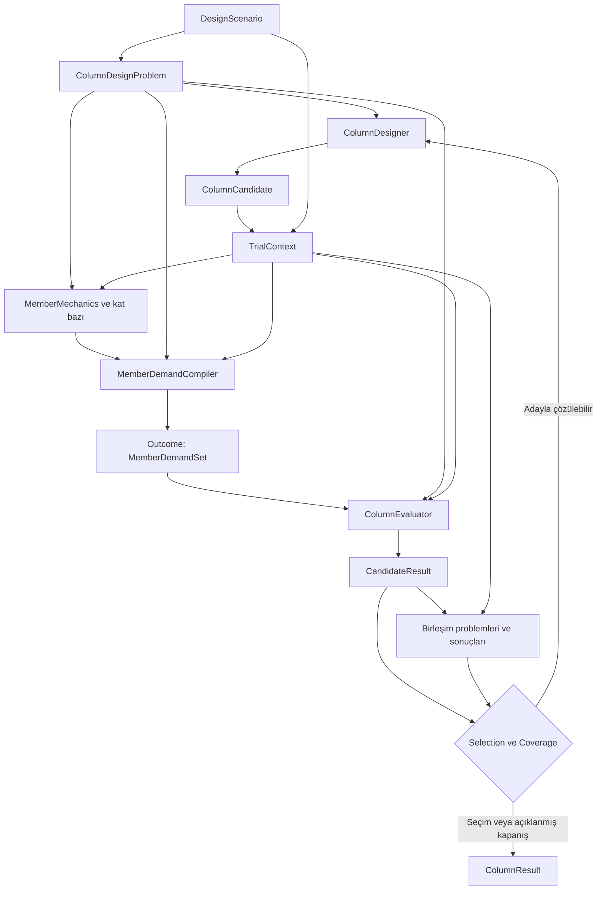

# Column Mimari Anayasası

> **GÖREVDEN ÖNCE OKU:** Bu üç belgenin tamamı okunmadan işe başlanmaz. İlk doğrulama `COLUMN_WORKER_AB.md` §1 içindedir. Anayasa veya görev özeti, tam okumanın yerine geçmez.

constitution_id: COLUMN-OOP-CONSTITUTION  
constitution_version: 1.3.1  
release_id: COLUMN-OOP-1.3.1-20261022  
date: 2026-10-22  
canonical_path: COLUMN_CONSTITUTION.md  
repository: feridunfc/Column  
status: BINDING_DESIGN / IMPLEMENTATION_NOT_YET_ACCEPTED

Bu belge, önceki v1.1 mimari tasarımını, v1.2 değerlendirmelerini ve v1.3 kararlarını tek bağlayıcı metinde birleştirir. Kullanıcının 22 Ekim 2026 tarihli kararıyla main yalnız bu üç kök belgeden başlar; eski repository ağacı `legacy/column-pre-clean-20261022` dalında, `873e48e6ebc9c1c345d10d7d1962d7ee7af49a91` commit’inde korunur. Önceki belgeler tarihsel gerekçe olarak kalır; alternatif bir uygulama otoritesi değildir. Bu sürümde iç birimler N–mm–Nmm–MPa olarak kesinleştirilmiş, A/B kesit pilotu ilk uygulama olarak seçilmiş, Worker/Supervisor uyum kapıları eklenmiştir. Belgenin yayımlanması, mimarinin kodda tamamlandığını veya gerçek bir kolonun uygun bulunduğunu göstermez.

## 1. Yetki, kapsam ve uyumun anlamı

### C-01 — Tek bağlayıcı mimari

Worker ve Supervisor, işe başlamadan kökteki **üç belgenin tamamını** okumak zorundadır: `COLUMN_CONSTITUTION.md`, `COLUMN_WORKER_AB.md`, `COLUMN_SUPERVISOR.md`. Başlık veya özet okumak yeterli değildir. Görevlerdeki sürüm ve SHA-256 bağlantıları doğrulanır; uyuşmazlık varsa uygulamaya başlanmaz. Hash sözleşmesi UTF-8/BOM’suz içeriktir; Windows checkout için yalnız CRLF -> LF dönüşümü yapılır, başka boşluk veya içerik normalizasyonu yapılmaz.

İlk main ağacında yalnız bu üç belge vardır. `AGENTS.md`, araç, paket, test veya CI henüz yoktur. İlk okuma ve doğrulama Worker §1’deki bağımsız Python komutuyla yapılır. G0 sonrasında Worker’ın ilk A0 teslimi, bu okuma şartını kök `AGENTS.md` dosyasına ve sürüm/hash denetimini araç/test/CI’a taşır. Bunlar oluşunca sonraki görevler `AGENTS.md` dosyasını da okur. Legacy dalındaki AGENTS ve görevler güncel talimat değildir.

Platform talimatları ve açık kullanıcı talimatları geçerlidir. Kullanıcı mimariyi değiştirdiğinde bu karar görünür bir sürüm güncellemesine dönüştürülür; eski anayasa geçerliymiş gibi çalışmaya devam edilmez. Eski sprint promptları, sohbet alıntıları, örnekler, diyagramlar ve kodun mevcut davranışı bu anayasayı sessizce değiştiremez. Alt dizin talimatları anayasaya istisna yaratamaz; çelişki kaydedilir ve ilgili iş durdurulur.

### C-02 — Yüzde yüz uyum ve kontrollü değişiklik

“Yüzde yüz uyum”, **mevcut görevin bütün zorunlu maddelerinin kanıtlanması, korunan mimari sınırların ihlal edilmemesi ve açık sapma bırakılmaması** demektir. A/B kapanışı, bütün ürünün uygulanması anlamına gelmez. İlerideki bir servisi A/B’de uygulamamak, kapsam tablosunda ertelenmişse sapma değildir. A/B için zorunlu bir şeyi “sonra” diyerek atlamak sapmadır.

Worker ve Supervisor anayasa değişikliği, gizli istisna, tolerans gevşetmesi veya kapsam daraltması yapamaz. Rutin iç uygulama seçimleri, dış davranışı ve sınırları değiştirmiyorsa görev yetkisi içinde yapılır. Mimari değişiklik gerekiyorsa ilgili madde, öneri, gerekçe, etkiler ve test değişiklikleriyle `ChangeRequest` hazırlanır. Kullanıcının kabul ettiği karar sonrasında anayasa sürümü, bağlı görevler ve hash kilitleri birlikte güncellenir. Hash, dosya kimliğini doğrular; mühendislik doğruluğunu veya gerçekten okunmuş olmayı kanıtlamaz.

### C-03 — Etkin uygulama sınırı

Şimdiki uygulama yalnız **Adım A0: asgari repository/Python/okuma ve hash denetimi kurulumu**, **Adım A: temel sözleşmeler** ve **Adım B: verilmiş donatıyla `calculate_section`** akışıdır. A0; kök AGENTS, paket/test altyapısı, belge denetimi ve bunu çalıştıran küçük CI işini kapsar; bütün eski ürünü geri getirme izni değildir. `check_column`, `design_column`, aday araması, kat/birleşim hesap motoru, canlı ETABS, yeni veritabanı altyapısı ve bina nüfusu çalıştırması bu görevin dışındadır. Bunların aşağıdaki hedef sözleşmeleri korunur; boş kabuk sınıflarla uygulanmış gibi gösterilmez.

## 2. Ürün ve katmanlar

### C-04 — Modüler tek ürün

Uygulama `feridunfc/Column` içinde modüler bir Python ürünü olarak gelişir. Yeni repository, mikroservis ağı, genel workflow motoru veya `eval()` tabanlı formül dili bu başlangıcın ön koşulu değildir. Sayısal hesap çevrimdışı çalışmalıdır.

| Katman | Sorumluluk | Yasak bağımlılık |
|---|---|---|
| `tbdy_column_core/domain` | Kimlikler, geometri, malzeme, analiz anlamı, istek/sonuç tipleri | Physics, application, adapters, ETABS, HTTP, DB, raporlama |
| `tbdy_column_core/engineering` | Tipli hesap servisleri ve kernel orkestrasyonu | ETABS, HTTP, DB, UI, dosyadan gizli girdi |
| `tbdy_column_core/application` | Public kullanım senaryoları ve açık portlar | Somut native/DB sınıfına gizli bağ |
| `tbdy_column_core/adapters` | Kaynak ve depolama uyarlamaları | Alternatif mühendislik hesabı |
| `tbdy_column_core/reporting` | Aynı değişmez sonuçtan sunum | Karar/formül üretimi |
| `tbdy_column_core/physics` | Legacy’den seçilip doğrulanarak alınan saf çekirdekler | Kaynak otoritesi veya proje durumu |

`engineering/section_adapter.py`, yeni kesit yolunda `physics/section_capacity.py` erişiminin tek sınırıdır. Test oracle’ı üretim bağımlılığı olamaz. Composition root, dış bağımlılıkları açıkça bağlar.

### C-05 — Dört ayrı model ve üç kullanım

Fiziksel model, analiz modeli, tasarım modeli ve sonuç modeli ayrıdır. Analiz yenilenince fiziksel kolon nesnesi değişmez; aday değişince kalıcı fiziksel model üzerine yazılmaz.

| Public kullanım | Girdi | Dönüş ve iddia |
|---|---|---|
| `calculate_section` | Verilmiş kesit, malzeme, boyuna donatı, açık çözüm isteği | `SectionCapacityResult`; kesit sayısal hesabı |
| `check_column` | Sabit aday, üye ve senaryo | `ColumnResult`; gerekli birleşimler ve kapsam dâhil |
| `design_column` | İzinli seçenekler, üye ve senaryo | `ColumnResult`; denemeler, seçim ve arama kapanışı |

`CandidateResult`, evaluator’ın iç sonucudur; `check_column` public sonucunun yerine geçmez. İleride kontrol ve tasarım aynı evaluator’ı kullanır.

### C-06 — OOP ve veri sahipliği

Kimlik taşıyan mühendislik nesneleri entity; geometri/miktar gibi değerler value object; birkaç nesneyi birleştiren hesaplar servis; bağımsız matematik saf fonksiyon olur. Sığ kalıtım veya bileşim kullanılabilir. `ConcreteColumn -> DuctileColumn -> HighDuctileColumn` gibi kural bağlamından türetilen kalıtım ağacı kurulmaz.

Property yalnız ucuz ve yan etkisiz bilgi üretir. Property içinde ETABS, dosya/DB erişimi, kök çözümü, zarf taraması veya tasarım araması yapılmaz. Pahalı hesap açık istek ve politika alan metottur. Global aktif proje/ETABS oturumu arayan servis bulucu kullanılmaz.

### C-07 — Değişmezlik, revizyon ve bağımlılık

Paylaşılan domain değerleri ve hesap girdileri değişmezdir. İç koleksiyonlar da değişmez görünüm sağlar; yalnız `frozen=True` ile içeride değişebilir sözlük bırakmak yeterli değildir. Model, analiz, malzeme, aday, baz ve deneme referansları revizyon taşır. Etiket, dosya adı veya yalnız senaryo kimliği hesap eşitliği için yeterli değildir.

`with_section`, `with_cage` ve yeni analiz bağı yeni sürüm üretir. Sonuçlar yerinde güncellenmez. Yeniden kullanım anahtarı fiilen kullanılan geometri, malzeme yasası, cage, analiz rolü, kural/yöntem sürümü ve sayısal politikayı kapsar. Bağımlılığı bilinmeyen sonuç yeniden kullanılmaz. A/B için önbellek yazmak zorunlu değildir.

## 3. Birim, eksen ve kayıt sözleşmeleri

### C-08 — Kanonik miktarlar

İç skalerler **N, mm, Nmm, MPa** cinsindedir. Kullanıcı girişi ve rapor sunumu **kN, cm, kNm, MPa** destekler. Dönüşüm açık miktar kurucuları/özelliklerinde merkezileşir; mühendislik formüllerine dağılmış `*10`, `*1000`, `*0.1` dönüşümleri eklenmez.

| Tür | Kanonik birim | Açık arayüz örneği |
|---|---|---|
| `Length` | mm | `Length.cm(40)`, `.as_mm`, `.as_cm` |
| `Area` | mm² | `Area.cm2(100)`, `.as_mm2` |
| `LengthSquared` | mm² | `sqrt() -> Length` |
| `Inertia` | mm⁴ | `Inertia.cm4(...)`, `.as_mm4` |
| `Force` | N | `Force.kn(...)`, `.as_n` |
| `Moment` | Nmm | `Moment.kn_m(...)`, `.as_nmm`, `.as_kn_cm` |
| `Stress`, `ElasticModulus` | MPa | `.mpa(...)`, `.as_mpa` |
| `Angle` | Açık derece/radyan sözleşmesi | `Angle.deg(...)`, `.as_deg` |

`bool`, `NaN` ve sonsuzluk kurucularda ve aritmetik sonuçlarında reddedilir. İşaretli koordinat, kuvvet ve moment geçerlidir; pozitif çap/boyut şartı ilgili model alanında denetlenir. Örtük `float(quantity)` ile birim düşürülmez.

Desteklenen aritmetik: aynı tipte toplama/çıkarma, sonlu boyutsuz skalerle çarpma/bölme, `Length*Length -> Area`, `Stress*Area -> Force`, `Force*Length -> Moment`, `Inertia/Area -> LengthSquared` ve bu çarpımların ters sıraları. Desteksiz işlemler açık hata verir. `Area` ile `LengthSquared`, aynı boyutun farklı semantik kullanımlarıdır; örtük toplanmaz. Birim tipleri eksen/model/otorite hatalarını kendiliğinden önlemez.

### C-09 — Boyutlu sayısal politika

`NumericalPolicy`, geometri uzunluk toleransı, boyutsuz eksen toleransı, kuvvet dengesi toleransı, moment karşılaştırma toleransı, göreli tolerans, açı sayısı ve maksimum iterasyonu açık taşır. Mutlak tolerans doğru miktar tipinde, sonlu ve pozitif; göreli tolerans sonlu ve negatif olmayan boyutsuz sayı; sayım/sınırlar `bool` olmayan pozitif tamsayıdır. Alanın yanlış tipi sessizce dönüştürülmez.

Karşılaştırma ölçütü ilgili birimde `abs(a-b) <= atol + rtol*max(abs(a), abs(b))` olur. Aynı fiziksel girdinin farklı birimlerle verilmesi **toleransla eşdeğerlik** gerektirir; bit düzeyinde eşitlik gerekmez. Geometri, kök dengesi ve açısal ayrıklaştırma toleransları ayrıdır. Tolerans, yönetmelik sınırını gevşetmek için kullanılmaz. İstenen politika ile gerçekten uygulanan politika sonuçta görünür; desteklenmeyen alan yok sayılamaz.

### C-10 — Koordinat, işaret, referans ve boy

`LocalFrame`, açık başlangıç ve sağ elli ortonormal eksen üçlüsüdür: `e1 × e2 = e3`, `det(R)=+1`. Tek eksenin bağımsız işaret değiştirmesi genel dönüşüm sayılmaz. Dikdörtgende `b` yerel 2, `h` yerel 3 doğrultusundadır. Kesit hesabı geometrik merkez referanslıdır.

Altı bileşenli fiziksel `ActionVector`, kaynak/hedef eksen ve referansla taşınır:

`F_target = R F_source`

`M_target = R M_source + r × F_target`

`r`, hedef başlangıçtan kaynak başlangıca uzanan, hedef takımında yazılmış vektördür. Kaynak yazılımın kesit yüzü ve eksenel işaret kuralı ayrıca çözümlenir. Fiziksel `F1` ile kernel’in basınç pozitif `N` değeri, tanımlı işaret haritası olmadan eşitlenmez. Önce altı bileşen taşınır, sonra gereken kesit bileşenleri seçilir. Desteklenmeyen eleman doğrultusu/ofset açık `Unsupported` olur.

İncelenen kernel’de `M2=F*x3`, `M3=-F*x2`, basınç pozitif `N` sözleşmesi korunur. Nötr eksen normal açısı, eğilme ekseni adıyla karıştırılmaz. Fiziksel alt/üst uç, analiz I/J sırasından otomatik türetilmez. Merkez boyu, net boy, analiz boyu ve etkin boy farklı alanlardır; bilinmeyen boy başka bir boyla doldurulmaz.

### C-11 — İstasyon kimliği, geometri ve tepki anahtarı

| Tip | Zorunlu anlam | Kimlik kuralı |
|---|---|---|
| `StationRef` | Eşleme revizyonu, fiziksel üye, analiz parçası, istasyon kimliği, kesit tarafı ve gerektiğinde yüz kimliği | Mesafe içermez; float karşılaştırmasıyla kimlik kurulmaz. |
| `StationGeometry` | Nesne/parça/fiziksel mesafe, global nokta, yerel eksen ve eşleme toleransı | `StationRef`e bağlı konum bilgisidir. |
| `StepIdentity` | Tek değer, zarf max/min, mod veya zaman adımı; kaynak indeks/etiketi | Zaman gibi gerçek sayı tek başına kayıt kimliği değildir. |
| `ResponseKey` | Run, sonuç üretimi, case/combo, adım, istasyon ve kanal | Aynı koordinattaki farklı parçalar/yüzler korunur. |

Ham kayıtlar türetilmiş talep dalları eklenerek değiştirilmez. Türetilmiş anahtar ebeveyn `ResponseKey`, yöntem ve dal kimliğini taşır. Ortak uç satırlarını koordinatları eşit diye silmek veya iki kez toplamak yasaktır.

### C-12 — Analiz rolleri ve tepki anlamı

`AnalysisRun` tek tutarlı sonuç neslini tanımlar. `AnalysisBundle`, `DESIGN_FORCES`, `STABILITY_REFERENCE`, `DRIFT_REFERENCE`, `MODAL_REFERENCE` gibi açık rol/run bağlantıları taşır. Aynı run bütün roller için otomatik yeterli değildir; farklı run’lar da yalnız kimlikleri farklı diye otomatik reddedilmez. Kabul, yöntemin model/eşleme, yük tanımı, rijitlik/mertebe ve nüfus gerekliliklerine bağlıdır.

`SignedActionState`, birlikte oluşan işaretli durumu; `SpectralResponseSet`, modal/directional birleştirme büyüklüklerini; `EnvelopeSet`, alternatiflerin zarfını temsil eder. Bu tipler birbirinin yerine geçmez. Ayrı üye veya durum maksimumlarından sahte eşzamanlı vektör oluşturulmaz. Homojen modal nüfus başka bir run’dan tamamlanmaz. Desteksiz spektral yöntem açık eksiktir; bu anayasa TS 500 Eq.7.13 için yeni modal mühendislik yöntemi onaylamaz.

### C-13 — Kaynağın dört ayrı boyutu

Kaynak metadata’sı `producer`, `acquisition_mode`, `intended_use`, `response_semantics` alanlarını ayırır. Örneğin ETABS üretici, kaydedilmiş aktarım edinim biçimi, regresyon kullanım amacı olabilir. `ETABS/RECORDED/MANUAL/SYNTHETIC` tek enum içinde birbirini dışlayan kökenler sayılmaz. `SourceRef`, dosya/tablo/API, kayıt kimliği, birim ve edinim bağını taşır. Kaynak gerçekliği ile yönteme matematiksel uygunluk ayrı denetlenir.

### C-14 — Kapsama bağlı nitelendirme

Nitelendirme `role`, `method`, `consumer`, `input_revision` kapsamında sonuç üretir. Bağlamsız `is_qualified=True`, serbest `review_ref='approved'`, dolu metin veya dosya hash’i tek başına kabul değildir. Kanıt çözümlenebilir, ilgili kapsam/revizyona bağlı ve gereken yöntem için yeterli olmalıdır. Aynı kaynağın bir tüketicide kabulü başka tüketiciye otomatik taşınmaz. Eksik/uyumsuz kanıt açık issue üretir. Salt matematik kernel’i bütün proje kanıtını taşımaz; kabul kapısı sınırda çalışır.

### C-15 — Bilgi durumları

`Outcome[T]`, `Provided[T]`, `NotRequired`, `Missing`, `Unsupported`, `Unresolved` gibi ayrışımlı durumlarla temsil edilir. `Provided`, verinin bulunduğunu söyler; doğrulanmışlığını kendiliğinden söylemez. `NotRequired`, yöntem/kural ve ihtiyaç kimliği ile kapsamlı uygulanabilirlik kanıtı gerektirir. Eksik veriyi gereksiz saymak için kullanılamaz. Python nesnesinin kurulabilmesi kabul kapısından geçmesi anlamına gelmez.

Eksik alan, desteklenmeyen yöntem, çelişkili kaynak ve sayısal belirsizlik ayrılır. Girdisi hazır bağımsız hesaplar diğer girdinin eksikliğinde de yürür. Matematik kernel’ine yalnız başarılı ve doğrulanmış sayısal girdi girer. Sessiz sıfır/ankastre/varsayılan veri veya `except Exception: return PASS` yasaktır.

## 4. Nesne kataloğu ve hesap sahipliği

### C-16 — Fiziksel modelin nesneleri

| Nesne | Sahip olduğu özellikler | Davranış / sınır |
|---|---|---|
| `Project` | Model ve senaryo referansları | Proje düzenler; formül çözmez. |
| `StructuralModel` | Eleman, düğüm, kesit, malzeme indeksleri | `validate_references`, kimlikle çözümleme |
| `Building`, `Story` | Yapı/kat üyeliği ve kotlar | Kat yüksekliği kolon net boyu değildir. |
| `StructuralSystem`, `SeismicUnit` | Yön ve ilgili nüfus | Bütün projeyi tek sisteme zorlamaz. |
| `PhysicalJoint`, `ConnectionGraph` | Fiziksel uç bağlantıları ve yüzler | Yakın koordinatı monolitik bağlantı saymaz. |
| `ColumnMember`, `BeamMember` | Fiziksel uçlar, atamalar, sistem üyeliği | Analiz elemanı veya tasarım sonucu değildir. |
| `MemberEndRef`, `MemberRegion` | Uç ve boy boyunca bölge kimliği | I/J, alt/üst, sargı/orta/ek bölgesini ayırır. |
| `SupportDefinition`, `EndConnection` | Fiziksel kısıt ve bağlantı | Analiz release’iyle kendiliğinden eşit değildir. |
| `ColumnStack` | Katlar boyunca üyeler | Gelecekte süreklilik; A/B’de uygulanmaz. |

Ortak nesne birden fazla kolonda kopyalanmaz; revizyonlu referansla çözülür. `MemberAnalysisMap`, bir fiziksel üyeyi bir veya birkaç analiz parçasına açık yön/ofset ve aralıklarla bağlar; boşluk/çakışma/nüfus doğrular. Desteklenmeyen çoktan-bire idealizasyon kabul edilmiş sayılmaz. Gelecekte perde/döşeme/temel kolon alt sınıfı olmaz.

### C-17 — Kesit, donatı ve yerleşim

`RectangularSection` yalnız geometridir. `area=b*h`, `i22=b*h³/12`, `i33=h*b³/12`; brüt atalet analiz rijitlik çarpanıyla değişmez. `RCSection`, tek profil, revizyonlu malzeme takımı ve verilmiş boyuna yerleşimi birleştirir. A/B’de tam enine cage gerektirmez; paspayı kontrolü için etriye dış sınırı/çapı girdi olabilir. Layout içinde ikinci bir bağımsız profil kopyası tutulmaz.

`BarPoint`, benzersiz kimlik, yerel merkez koordinatı, çap ve çelik referansı taşır. `LongitudinalLayout`, gerçek ayrık çubukları tutar; toplam As gerçek yerleşimin yerine geçmez. Paspayı beton dışından etriye dış yüzüne ölçülür: çubuk merkezi kenardan en az `cover + tie_diameter + diameter/2` uzaktadır. Sınır dışı, yinelenen veya çakışan çubuk reddedilir. Bu geometrik denetim, yönetmelik minimum net aralık kontrolü diye raporlanmaz.

Tam üye aşamasında `TieShape`, `Crosstie`, `TransverseLayout` gerçek kol/çiroz ve tutulan çubuk geometrisini; `RebarCage` boyuna ve bölgesel enine düzenleri taşır. `RebarRequirement`, `RebarOptions` ve gerçek seçilmiş cage farklıdır. ETABS gereken donatı alanı seçilmiş fiziksel donatı sayılmaz.

### C-18 — Malzeme ve destek sınırı

`ConcreteMaterial` ve `RebarSteel` karakteristik özellikleri; `RCMaterialSet` malzeme referanslarını; `DesignMaterial` açık hesap dayanımları, katsayılar, model/yasa kimliğini taşır. Karakteristik malzeme ile yönetmelikten/proje bazından türetilmiş hesap değerleri ayrıdır. A/B’de `fcd`, `fyd`, `Es`, `epsilon_cu`, `k1` açık verilmiş model girdileridir; gizli katsayı seçilmez.

Mevcut dikdörtgen kernel’i bütün boyuna çubuklara tek `fyd` ve `Es` uygular. A/B homojen hesap çeliğini destekler; farklı `steel_ref` değerleri farklı hesap yasasına çözülüyorsa `Unsupported` olur. Referanslar aynı hesap yasasına çözülebiliyorsa sırf etiket farklı diye fiziksel farklılık uydurulmaz. Karma çelik sessizce tek çeliğe indirgenmez. Yeni yasa/daire/poligon kesit ancak ayrı kabul sonrasında desteklenir.

### C-19 — Kesit isteği ve public sözleşme

```python
calculate_section(problem: SectionCapacityProblem) -> SectionCapacityResult
```

`SectionCapacityProblem`: `RCSection`, ayrışımlı istek, `NumericalPolicy`, açık eksen/model sözleşmesi ve girdi referanslarıdır. Public facade application katmanındadır; hesap `SectionSolver`a delege edilir. Desteklenen istekler:

| İstek | Girdi | Sonuç |
|---|---|---|
| `AtStrainState` | Nötr eksen normal açısı, pozitif `c` | `N/M2/M3`, gerinim durumu; hedef N kalanı uygulanmaz. |
| `EnvelopeAtAxialForce` | Hedef basınç pozitif `N` ve açı politikası | Açı bazında kapasite durumları ve gerçek kalanlar |
| `RadialCapacityAtAxialForce` | Hedef `N`, sıfır olmayan moment yönü | Aynı N düzleminde radyal kapasite ve kullanılan zarf |

Sıfır moment yönü `UndefinedMomentDirection` gibi tanımlı durumdur; sonlu miktar nesnesine sonsuzluk sokulmaz. Çözülebilen açıların verisi, başka açılar çözülemedi diye kaybolmaz; kısmi zarf tam kapasite zarfı diye kullanılamaz. Eksik kapsam genel yapısal imkânsızlık değildir.

### C-20 — Kernel uyarlaması ve gerçek sayısal kalite

`SectionKernelAdapter`, miktarların kanonik özelliklerini açıp mevcut saf matematiği çağırır; formülleri kopyalamaz. İncelenen `section_capacity.py` davranışları:

- `solve_capacity_state_for_axial_force`, eksenel tolerans ve `max_iterations` alır; `build_interaction_envelope_at_axial_force` iterasyon parametresi almaz. Uyarlayıcı gerekli politikayı açı başına tek durum çözücüsüne iletebilir. İletilmeyen politika uygulanmış gibi raporlanamaz.
- Dönen durumun gerçek N kalanı uygulamanın ilan ettiği toleransla yeniden kontrol edilir. Kernel’in daha gevşek son kabulü otomatik kabul değildir.
- `OUTSIDE_AXIAL_CAPACITY` etiketi, bütün başarısız kök taramalarında fiziksel imkânsızlığı kanıtlamaz. Sayısal belirsizlik ayrımı korunur.
- Sıfır moment talebindeki `math.inf` domain/JSON’a taşınmaz.
- Kernel’in döndürmediği iterasyon veya kök sayısı uydurulmaz. Bağımsız denetimde çoklu kök görülürse açık seçim kuralı olmadan ilk kök kesin sonuç sayılmaz.

`SectionCapacityResult`, istenen/uygulanan politika, gerçek kalan, açı adımı/sayısı, yöntem/model/kernel sürümü, kısmi sonuç ve issue’ları taşır. Sabit gerinim isteğinde mevcut olmayan hedef N kalanı sıfır diye uydurulmaz. Konveks zarf yaklaşımı kullanılan model varsayımı olarak görünür.

### C-21 — Üye mekaniği ve talep üretimi

Bu bölüm hedef sözleşmedir; A/B’de uygulaması yoktur. `MemberMechanics.prepare_geometry(problem)`, `prepare_stiffness(problem, geometry, trial)` ve `resolve(geometry, stiffness, story, basis)` ayrıdır. Kat hesabının ön girdileri, kat sonucuna bağlı nihai mekanikle yapay döngü kurmaz. Gerekmeyen kat girdisi yalnız kanıtlı `NotRequired` olur.

`MemberDemandCompiler.compile(problem, trial, mechanics_outcome) -> Outcome[MemberDemandSet]` ham kayıtları değiştirmez. Ebeveyn anahtarları, beklenen case/step/istasyon/dal/yön nüfusu, dönüşüm izi ve etki kapsamını korur. İkinci mertebe için tek `already_amplified=True` yeterli değildir; global/yerel etki, yön, durum ve yöntem ayrılır. Gerekli etki atlanmaz veya iki kez uygulanmaz.

`ColumnEvaluator.evaluate(problem, trial, demands_outcome) -> CandidateResult` açık talep girdisi alır; compiler’ı gizlice çağırmaz. `trial`, hedef adayın tek yetkili referansını çözer. Talep hazır değilse ona bağımlı kontroller eksik kalır; geometri gibi bağımsız kontroller yürür. Evaluator aday seçmez veya cage değiştirmez.

### C-22 — Senaryo, aday ve deneme

`DesignScenario`, sabit fiziksel model, `AnalysisBundle`, tasarım bazı, kapsam ve kalıcı aday atamalarını bağlar. `ColumnDesignProblem`, hedef, senaryo, değişmez model/komşuluk görünümü, analiz eşlemesi, `RequiredScope` ve tam olarak bir `CheckRequest`/`DesignRequest` taşır. Girdiler çalışma ortasında dış sistemden gizlice aranmaz.

`ColumnCandidate`, tam üye aşamasında kesit/malzeme ve gerçek tam cage atamasıdır. `TrialContext`, sabit senaryo üzerine geçici değişmez aday atamalarını bindirir; kaynak senaryoyu değiştirmez. `ColumnDesigner` yalnız hedef atamayı değiştirir. Komşuların birlikte tasarımı `ProjectDesigner` yetkisindedir. Aynı adayın PMM, kapasite kesmesi, sargı ve birleşim bağı korunur. Cage değişimi yeni denemedir.

### C-23 — Kat ve birleşim sahipliği

`StoryStabilityService`, tam ilgili kat/sistem/yön/yük nüfusunun sahibidir; yalnız hedef kolon kat nüfusu sayılmaz. Sonuç ilgili bağımlılık anahtarıyla paylaşılır. `JointProblemBuilder`, deneme bağlamından gerekli bütün üst/alt birleşim, yön ve durum problemlerini kurar; kurulamayan anahtarları listeden düşürmez.

`JointEvaluator`, bağlı üyelerin uyumlu aday ve `EndCapacityState` durumlarını kullanır. Uç kapasitesi; üye/aday, fiziksel uç/yüz, koordinat/yön/işaret, eksenel kuvvet bazı, kapasite tanımı, yasa ve sayısal kaliteyi taşır. Kiriş kapasitesi yalnız kesit boyutundan uydurulmaz. Birleşim bir kez hesaplanır; kolon `related_joint_results` referansları taşır. Eksik birleşim, geçerli bağımsız üye sonuçlarını silmez.

### C-24 — Sonuç, kapsam ve uygun aday seçimi

| Sonuç boyutu | Değer/anlam |
|---|---|
| `applicability` | APPLIES / DOES_NOT_APPLY / UNDETERMINED |
| `execution` | COMPLETED / MISSING_INPUT / UNSUPPORTED_METHOD / NUMERICAL_FAILURE / INTERNAL_ERROR |
| `compliance` | PASS / FAIL / NOT_EVALUATED |
| `coverage` | Dışarıdan tanımlı beklenen anahtarlar ve gerçekleşen sonuçlar |
| `freshness` | CURRENT / STALE / UNKNOWN |

`CheckResult` ortak başlık ve kontrole özgü tipli payload taşır. Beklenen kapsam yalnız bulunan sonuçlardan türetilemez. Boş liste PASS olamaz. Bilinen FAIL ile eksik bilgi birlikte korunur.

`CandidateAssessment.eligibility`: ELIGIBLE / REJECTED / UNDETERMINED; `is_complete` ve `has_failures` ayrıca türetilir. PMM FAIL + eksik üst birleşim, REJECTED + incomplete + has_failures durumudur. Tam/güncel zorunlu kapsamın bütün uygulanabilir kontrolleri uygun olmadan ELIGIBLE üretilmez. Sayısal kesit çözümü kendi başına kod uygunluğu vermez.

### C-25 — Tasarım çevrimi ve kapanış

Hedef ürün akışı aşağıdaki veri bağımlılıklarına uyar; A/B bunun kesit alt yolunu uygular:



Mekanik hazırlanamazsa compiler tipli başarısız outcome üretir; evaluator’ın bağımsız kontrolleri yine çalışabilir. Designer bu akışın orkestratörüdür. Kapsam toplama veya rapor formül hesaplamaz.

Arama sırası, eşitlik bozma, deneme/iterasyon sınırı ve kapanış nedeni açıktır. İlk tam uygun aday politikası global optimum iddiası taşımaz. `SEARCH_EXHAUSTED`, `SEARCH_LIMIT_REACHED`, `PROJECT_INPUT_REQUIRED`, `UNSUPPORTED_METHOD`, `ANALYSIS_UPDATE_REQUIRED`, `NUMERICAL_FAILURE`, `CANCELLED` ve teknik hata ayrılır. Yeni donatıyla çözülemeyecek eksikte aynı döngü sürdürülmez. Normal kapanışlarda seçim olmasa da `ColumnResult` üretilir; teknik hata uygunluk hükmüne çevrilmez.

### C-26 — Yeniden hesaplama ve kalıcı veri

Boyuna düzen değişimi kapasite/PMM/kapasiteye bağlı kesme ve birleşimleri; yönteme göre EI/talepleri yeniler. Enine düzen değişimi kesme/sargı/çubuk tutulmasını ve etkilediği model girdilerini yeniler. Komşu kiriş değişimi ilgili birleşimleri; analiz rolü değişimi o rolün tüketicilerini yeniler. Yalnız rapor dili değişimi hesabı yenilemez.

Hedef kalıcılık, SQLite metadata indeksi ve değişmez girdi/sonuç paketleridir. Paket mühendislik doğruluk kaynağıdır; indeks yeniden kurulabilir. Şema/migration sürümü, strict JSON, atomik dosya yayını ve DB referansının tutarlılığı korunur. Zaman damgası mühendislik içerik hash’ine karıştırılmaz. Pickle ve gizli çalışma ortamı bağımlılığı kullanılmaz. A/B’de DB veya ince taneli cache altyapısı kurulmaz; seri hale getirilebilir sonuç yeterlidir.

### C-27 — Native sınırı

ETABS erişimi gelecekte açık `AnalysisSource` portuyla bağlanır; tek STA/native sahibi kullanılır. Matematik worker’ına COM nesnesi verilmez. Çıktı istemeden case/combo seçimi açık kurulup doğrulanır; önceki seçim geri yüklenir. Bu, getter-only diye adlandırılmaz. Boş sonuç ile gerçek sıfır ayrılır; beklenen eleman/case/step/istasyon nüfusu denetlenir.

Timeout iptal kanıtı değildir; geç sonuç başka isteğe bağlanmaz. Kaydedilmiş aktarım aynı hesap yolunu kullanır. Mevcut gateway bağımsız kabul sonrasında dar uyarlayıcıyla kullanılabilir; büyük eski orkestrasyon kopyalanmaz. A/B’de canlı ETABS, analiz, tasarım veya model değişikliği yapılmaz.

### C-28 — Aynı sonuçtan rapor

JSON ve okunabilir HTML rapor **aynı `SectionCapacityResult`** nesnesinden üretilir. Sayısal birim sunumu/yuvarlama dışında hesap yapılmaz. Rapor girdi ve aday kimliği, model/varsayım, birimler, kullanılan yöntem/politika, kapasite durumları, gerçek kalanlar, kısmi kapsam ve eksikleri gösterir. `NaN/Infinity` JSON’a yazılmaz; `allow_nan=False` kullanılır. Determinizm aynı sabit içerik ve politika içindir; değişken edinim zamanı ayrıca taşınır.

Üye aşamasında aynı kural `ColumnResult` için geçerlidir. Kesit yakınsaması, testlerin geçmesi veya tek PMM oranı “kolon tamamen uygun” diye sunulmaz. A/B raporunda uygulanmayan narinlik, ikinci mertebe, kesme, sargı, birleşim ve detaylandırma açık kapsam dışıdır.

## 5. Kabul, geçiş ve denetim

### C-29 — Bağımsız sayısal kabul

Üretim çıktısı beklenen değer olarak kopyalanmaz. Legacy dalındaki `tests/independent/oracle.py`, A0/B sırasında test bağımlılığı olarak seçilip kaynak referansı korunarak alınır; doğrudan durumlar için bağımsız strip integrasyonu, hedef N için ayrı kök denetimi ve sık açılı radyal referans sağlar. Aynı malzeme idealizasyonu ve bazı zarf varsayımları paylaşılır; bu karşılaştırma sayısal uygulama denetimidir, bağımsız yönetmelik/model onayı değildir.

Asimetrik kesit, iki gerçek donatı düzeni, dönüşüm ve negatif kabul durumları zorunludur. Çubukların sırasını değiştirmek fiziği değiştirmez. Her farklı düzenin her koşulda kapasiteyi değiştirmesi şart koşulmaz; seçilmiş referanslardaki fark bağımsız hesapla karşılaştırılır. Doğrudan durum toleransı, eksenel denge toleransı ve açı yakınsama hatası ayrı ölçülür. Çoklu kök/eksik zarf/karma çelik gibi destek sınırları sınanır. Test sayısı ürün tamamlanması değildir.

### C-30 — Geçiş ve geçmişin korunması

Legacy dalında eski kod, API, fixture, test ve kanıtlar özgün ağaç olarak korunur; kullanıcı çalışma ağacı silinmez. Yeni main’de eski API/test paketinin tamamını bulundurmak zorunlu değildir. A0/B yalnız ihtiyaç duyduğu kernel, bağımsız oracle ve yardımcıları kaynaklarıyla seçerek alır; bütün eski orkestrasyon, test ağı veya workflow geri getirilmez. Alınan matematiğin eski davranışı ayrı referans/bağımsız testlerle korunur. Tarihsel adlar yeni public API’ye taşınmaz; eski kanıt/kod geçmişi silinmez. `rebar_layout.py` içindeki saf geometri ile yönetmelik filtreli aday üretimi aynı şey sayılmaz. A/B aday üreticisini içeri almaz. Formüller genel yeniden yazıma tabi tutulmaz; kanıtlı hata ayrı görünür düzeltme ve bağımsız regresyon gerektirir. Test beklentisi değiştirilerek hata saklanamaz.

Drive `example_calcs` dosyaları gereksinim/referans kaynağıdır: donatı seçimi, kesme/sargı ve kat hesabının farklı sahiplikleri vardır. Aynı spreadsheet formülünü iki tarafa kopyalamak bağımsız oracle değildir. Referans fixture gerçek B-BLOK/235 veya canlı proje kanıtı gibi etiketlenmez.

### C-31 — Adımlar ve tamamlanma

| Adım | Bitiş ölçütü | Şimdiki görev |
|---|---|---|
| A0 + A | Asgari repo/Python/okuma ve hash kapısı; birim/eksen/kimlik, bilgi durumu, rol/kanıt sözleşmeleri | Zorunlu |
| B | `calculate_section` public yolundan bağımsız doğrulanmış sonuç ve aynı JSON/HTML | Zorunlu |
| C | Verilmiş tam cage ile `check_column`, üye mekaniği ve talep üretimi | Ertelenmiş |
| D | Aynı adayda kesme, sargı ve kapsam içi detaylandırma | Ertelenmiş |
| E | Tam kat nüfusu, gerekli bütün birleşimler, aynı `ColumnResult` | Ertelenmiş |
| F | Gerçek kaydedilmiş model/sonuçla aynı public yol ve kabul edilmiş kapsam | Ertelenmiş |
| G | Ayrıca yetkili native edinim ve yaşam döngüsü kabulü | Ertelenmiş |
| H | Nüfus, performans ve gerekirse gelişmiş arama | Ertelenmiş |

İlk uygulama A/B’dir. İlk **üye** uygulaması C’de `check_column` olacaktır; sonra `design_column` aynı evaluator’a arama ekler. A/B için kolon/bina motoru bitiş koşulu getirilemez. Buna karşılık yalnız class/constructor veya JSON üretmek de B kapanışı değildir.

### C-32 — Worker/Supervisor kapıları ve sapma

Tek uygulayıcı Worker ve ayrı kabul sahibi Supervisor kullanılır. Worker küçük tamamlanmış parçalar halinde commit eder; Supervisor aynı HEAD/tree ve kanıtlar üzerinde karar verir. Supervisor formül uydurmaz, kapsamı büyütmez, anayasayı değiştirmez veya kanıtsız PASS vermez. A/B’nin test sayısı yerine public akışı ve mühendislik riskleri denetlenir.

Başlangıç kaydı; rol, task, branch/HEAD, anayasa sürümü/hash’i, görev hash’i, A/B kapsamı, tam okuma beyanı ve beş temel kuralın kısa açıklamasını taşır. Salt hash kontrolü okuma/anlama kanıtı değildir; bu beyan ve kod incelemesi ayrıca gereklidir.

Her C-01…C-32 maddesi için uyum defteri tutulur: `SATISFIED`, `PRESERVED_DEFERRED`, `VIOLATION` veya `UNVERIFIED`. A/B’de ertelenmesine izin verilen madde parçaları açık gerekçeyle korunur; zorunlu parça bu etiketle atlanamaz. `VIOLATION` veya zorunlu `UNVERIFIED` varken A/B kabul edilmez. Bulgular madde, dosya/sembol, kanıt ve düzeltme ölçütü taşır. Tek açık görev kuyruğu vardır; aynı kapalı iş sebepsiz yeniden açılmaz.

Üç belgeli ilk ağaçta başlangıç doğrulaması Worker §1’deki Python komutuyla yapılır. A0 tesliminden itibaren başlangıç ve her kapanışta `python tools/check_architecture_contract.py` çalıştırılır; bu araç aynı UTF-8/LF hash sözleşmesini uygular. A0, sürüm/hash denetimini unittest keşfine ve CI’a bağlar. Yeni main’in üç belgeli başlangıcında çalışan test/CI varmış gibi rapor verilmez; eski test/CI legacy’de korunmuştur. Yeşil hash kontrolü semantik mimari uygunluğun yerine geçmez. Worker A0’da başlangıçta doğrulanmış üç belge hash’ini kilitler; sonra bu kilitleri kendi uygulama sapmasını geçirmek için değiştiremez. Anayasa değişikliği ancak C-02 süreciyle yeni sürüm olarak yayımlanır.

## İncelenen kaynaklar ve sürüm notu

Kod gözlemleri `Column@fc303e85b19c490a3dbbfbeb0bf67bd86c8d41ed` kesitine bağlıdır. Yeni checkout farklıysa ilgili imzalar yeniden kontrol edilir; sürüm farkı tek başına gizli mimari değişiklik yetkisi vermez. Önceki tasarımda incelenen `TBDY@1440df1b9300f75b1e604204438f5cada9ebd247` ve Drive örnekleri tarihsel bağlamdır. Bu belge yeni normatif formül kabulü yapmaz.

- [Column referans kesiti](https://github.com/feridunfc/Column/tree/fc303e85b19c490a3dbbfbeb0bf67bd86c8d41ed)
- [Kesit kernel’i](https://github.com/feridunfc/Column/blob/fc303e85b19c490a3dbbfbeb0bf67bd86c8d41ed/tbdy_column_core/physics/section_capacity.py)
- [Bağımsız oracle](https://github.com/feridunfc/Column/blob/fc303e85b19c490a3dbbfbeb0bf67bd86c8d41ed/tests/independent/oracle.py)
- [Yerleşim modülü](https://github.com/feridunfc/Column/blob/fc303e85b19c490a3dbbfbeb0bf67bd86c8d41ed/tbdy_column_core/physics/rebar_layout.py)
- [Drive example_calcs](https://drive.google.com/drive/folders/1cr6tfw2THbdcYWBdQp61Xr6SWaAq-THF)

v1.3.0: iç birimler tekleştirildi; istasyon/tepki kimlikleri ayrıldı; kanıt nitelendirmesi kapsama bağlandı; kesit istekleri ve kernel destek sınırları kesinleştirildi; A/B ve sonraki üye pilotu çelişkisi giderildi; üç belge ve repo başlangıç/CI denetimi aynı sürüme bağlandı.

v1.3.1: Kullanıcı kararıyla main yalnız üç kök belgeye indirildi; eski ağaç legacy dalına bağlandı. Kök yollar, Windows LF hash sözleşmesi ve araçsız ilk okuma/doğrulama tanımlandı. AGENTS, Python, test ve CI kurulumu ilk Worker A0 teslimine alındı. Mühendislik hesap sözleşmeleri değiştirilmedi.
